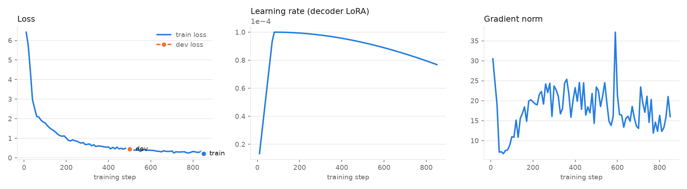
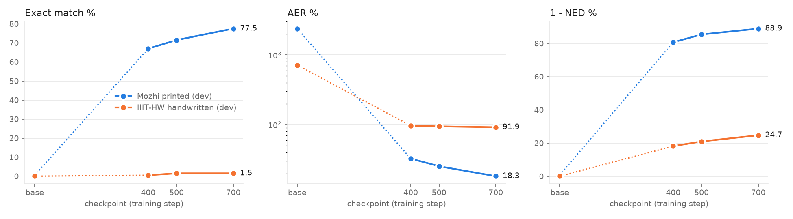

# HindiDoc-OCR

Fine-tune **DeepSeek-OCR 2 (3B)** to read **Hindi + English documents**, printed and handwritten. For each page it returns **grounded bilingual blocks**: box, layout label, reading order, source text and English translation. A separate renderer rebuilds the translated PDF from them.

> **Status (2026-11-27):** Stage 1A (printed Hindi) is training: 2 epochs × 80K Mozhi samples = 2,500 steps at global batch 64, LoRA on DeepEncoder V2 + decoder attention (3.05M trainable parameters), on one L4. Checkpoints are evaluated on an RTX 3060 as they arrive. Results below.

| Milestone | Date | Deliverable |
|---|---|---|
| M1 | 2026-12-20 | Hindi document reader: reading + layout, compared with the untrained model |
| M2 | 2027-01-17 | Reader + translator in one model, final report |

## Results so far: Stage 1A (printed Hindi)

**Training** (logged to W&B every 10 steps; dev loss every 500 steps on 2,000 held-out Mozhi words):

<picture>
  <source media="(prefers-color-scheme: dark)" srcset="docs/assets/training-dark.png">
  
</picture>

**Dev-set scores per checkpoint** (public data only: 200 Mozhi printed words and 200 IIIT-HW handwritten words from the official val splits; never trained on):

<picture>
  <source media="(prefers-color-scheme: dark)" srcset="docs/assets/eval-dark.png">
  
</picture>

| Mozhi printed (dev, 200 words), % | base | step 400 | step 500 | step 700 |
|---|---|---|---|---|
| CER ↓ | 1442.2 | 29.5 | 22.5 | **16.8** |
| AER ↓ | 2383.6 | 32.6 | 25.3 | **18.3** |
| WER ↓ | 659.5 | 33.0 | 28.5 | **22.5** |
| Matra error rate ↓ | 100.0 | 42.5 | 30.1 | **22.2** |
| 1 - NED ↑ | 0.8 | 80.7 | 85.4 | **88.9** |
| Exact match ↑ | 0.5 | 67.0 | 71.5 | **77.5** |

| IIIT-HW handwritten (dev, 200 words), % | base | step 400 | step 500 | step 700 |
|---|---|---|---|---|
| CER ↓ | 388.8 | 86.6 | 85.8 | 83.1 |
| AER ↓ | 714.7 | 96.7 | 94.7 | 91.9 |
| 1 - NED ↑ | 0.1 | 18.2 | 21.0 | 24.7 |
| Exact match ↑ | 0.0 | 0.5 | 1.5 | 1.5 |

- The base model mostly hallucinates (long HTML tables for a single word), so its error rates are far above 100%. 1 - NED and exact match are bounded and easier to compare.
- Handwriting barely moves: 1A trains on printed text only; handwriting is Stage 1B.
- The 1A gate is printed CER ≤ 3% on the full dev suite (2,000 words per source); step 700 is not there yet.
- Charts and tables: `python docs/assets/make_charts.py --run <entity>/<project>/<run id> --eval start=… --eval 700=…` (scores in `docs/assets/stage1a_dev_eval.json`). Latency per item appears from the next evaluation run on.

## How it works

Training runs in stages. Each stage adds a fresh LoRA adapter to the previous merged checkpoint, then merges it in turn. Stage 1 trains LoRA on DeepEncoder V2 attention (r8) and decoder attention (r16). SAM, the conv downsampler, `projector`, router, experts, embeddings and LM head stay frozen.

| Stage | What the model learns | Doc |
|---|---|---|
| 0 | Nothing (data, splits, baseline, smoke tests) | [stage-0](docs/stages/stage-0-data-and-baseline.md) |
| 1 | Read Devanagari + handwritten English: 1A printed → 1B handwritten → 1C joint with golden regions | [stage-1](docs/stages/stage-1-script-adaptation.md) |
| 2 | Whole pages: boxes, labels, reading order, text | [stage-2](docs/stages/stage-2-document-understanding.md) |
| 3 | Hindi + translation, text only (decoder branch) | [stage-3](docs/stages/stage-3-language-branch.md) |
| 4 | Reading + translation in one model | [stage-4](docs/stages/stage-4-joint-ocr-translation.md) |
| 5 | Final test, compression, renderer hand-off | [stage-5](docs/stages/stage-5-release.md) |

The full plan, with decisions, datasets, gates and timeline, is in [docs/training-plan.md](docs/training-plan.md). The tokenizer findings are in [docs/tokenizer-check.md](docs/tokenizer-check.md). Training speed (bottlenecks, kernels, profiling): [docs/training-throughput.md](docs/training-throughput.md).

## Repository layout

```
dataEngine/           raw data → validated records
  golden.py             golden pages → page records + validation
  splits.py             train/dev/test by writer group, locked once written
  tasks.py              training types: task registry (prompt, record kind) + shared record reader
  document_ir.py        grounded block format: serialize / parse
  prompt_registry.py    prompt registry files (training and evaluation each keep one folder)
  sources/              converter registry: one dataset → crop records
models/deepseek_ocr/  model input encoding, loading, generation (shared by training + evaluation)
training/             config → deterministic data plan → LoRA training (1..N GPUs)
  config.py             [stage], [data], [lora], [train], [smoke] of a run config
  stages.py             python -m training.stages: the stage tree from the configs
  lora.py / inventory.py / smoke.py / prompts.py
evaluation/           before/after runner (sharded), page metrics, report with gates, prompt leaderboard
tracking/             W&B + MLflow logging for training and evaluation, switched on by keys in .env
configs/
  data/                 data engine: training_data.toml, test_data.toml
  stage1/               one run config per sub-stage: 1a_printed, 1b_handwritten, 1c_joint
  eval/                 evaluation-only runs: test_data.toml
tests/                pytest, CPU only, no model download
docs/                 plan, stage docs, tokenizer check
outputs/              data, checkpoints, predictions (git-ignored)
report/               evaluation reports (git-ignored); report/prompts/ tracked
```

Each folder has its own README: [configs](configs/README.md) · [dataEngine](dataEngine/README.md) · [models](models/README.md) · [training](training/README.md) · [evaluation](evaluation/README.md) · [tracking](tracking/README.md) · [report](report/README.md) · [tests](tests/README.md) · [docs](docs/README.md).

## Stages and training types

**Training type = a task in `dataEngine/tasks.py`.** Each task defines:
- its prompt;
- the record kind it reads;
- how a record becomes (prompt, target, image).

| Task | Records | Used in |
|---|---|---|
| `crop_ocr` | crop folders (`python -m dataEngine … crops`) | Stage 1A / 1B / 1C |
| `page_parse` | `pages.jsonl` + locked splits + image root | Stage 2, page evaluation |

**Stage or sub-stage = one run config in `configs/stage<N>/`.** Its `[stage]` section names it and links it to the stage it starts from:

```toml
[stage]
id = "1B"
description = "handwritten Hindi + English crops, separate adapter on 1A"
starts_from = "1A"   # [model].name_or_path is 1A's merged output; "base" = original OCR-2
```

`python -m training.stages` prints the tree, with each stage's tasks, data mix and status (merged output, report):

```
base  (original model)
    └─ 1A: printed Hindi crops (public data only)
        └─ 1B: handwritten Hindi + English crops, separate adapter on 1A
            └─ 1C: joint printed + handwritten replay with golden regions
```

**How to add things:**

| To add | Do |
|---|---|
| A sub-stage | Add a config to its stage folder |
| A new stage | Add a new `configs/stage<N>/` folder |
| A new training type | Register one function in `TASKS` |

Data sources can mix tasks and record kinds. Each source can set its own `image` mode (e.g. tiles for pages).

## Setup

Python 3.12.

**CPU / data machine:**

```bash
python -m venv .venv && source .venv/bin/activate      # Windows: .venv\Scripts\activate
pip install -e .[dev]
```

**GPU machine (CUDA 11.8):**

```bash
pip install -r requirements.txt                          # pyproject.toml [train,dev] + the CUDA 11.8 torch index
pip install flash-attn==2.7.3 --no-build-isolation      # or set attn_implementation = "eager"
cp .env.example .env                                    # optional: W&B / MLflow keys (tracking/)
```

The model's own code needs transformers **4.46.3**, which is pinned. Do not upgrade it.

## Quickstart

```bash
# 1. Data engine (add --workers N to use N CPU processes)
python -m dataEngine --config configs/data/training_data.toml golden                          # validate golden pages
python -m dataEngine --config configs/data/training_data.toml split                           # lock train/dev/test
python -m dataEngine --config configs/data/training_data.toml crops --source golden_regions   # region crops
python -m dataEngine --config configs/data/training_data.toml crops --source mozhi_hi         # downloads/mozhi_hi (train/dev/test)
python -m dataEngine --config configs/data/training_data.toml crops --source iiit_hw_dev      # downloads/iiit_hw_dev

# 2. Check what a config will train (builds the model without weights)
python -m training.inventory --config configs/stage1/1a_printed.toml

# 3. Smoke tests on one GPU (needs only the golden crops)
torchrun --nproc_per_node=1 -m training --config configs/stage1/1a_printed.toml --smoke
torchrun --nproc_per_node=1 -m training --config configs/stage1/1a_printed.toml --profile 20   # Chrome traces of steps 3-22

# 4. Evaluate before training (the run's starting model)
torchrun --nproc_per_node=N -m evaluation --config configs/stage1/1a_printed.toml --checkpoint start

# 5. Train: the same command on 1 or N GPUs (needs every source in the config)
torchrun --nproc_per_node=N -m training --config configs/stage1/1a_printed.toml

# 6. Evaluate after training: before vs after, with gates
torchrun --nproc_per_node=N -m evaluation --config configs/stage1/1a_printed.toml \
    --checkpoint start --checkpoint outputs/runs/stage1a_printed/merged

# 7. Next sub-stage starts from the best checkpoint, merged
python -m training --config configs/stage1/1a_printed.toml --merge outputs/runs/stage1a_printed/checkpoint-3000
```

**Outputs:**

| Step | Where |
|---|---|
| Data | `outputs/data/` |
| Training | `outputs/runs/<run>/`: checkpoints, TensorBoard logs, `run_manifest.json`, `smoke.json`, `adapter/`, `merged/` |
| Evaluation | predictions per checkpoint in `<checkpoint>/eval/<split>/` (`start` and hub ids under `[eval].output_dir`), private; report in `report/<run>/report_<split>.md` + `.json` (git-ignored: comparisons quote private text) |

## Configuration

Every run is one TOML file in `configs/`: data engine (`configs/data/`), one training config per stage/sub-stage (`configs/stage<N>/`), evaluation-only suites (`configs/eval/`). Section-by-section reference, image modes and how to add a run: [configs/README.md](configs/README.md). A misspelled key fails loudly; nothing falls back to a hidden default.

## Extending

| To add | Do |
|---|---|
| A public dataset in "images + label file" form | Add a `[[sources]]` block with `converter = "labelled_folder"` in `configs/data/training_data.toml` |
| A dataset in a new format | Write `convert(source, out_dir, workers)` in `dataEngine/sources/` and register it in `CONVERTERS` |
| A new task (prompt/target) | Write one function in `dataEngine/tasks.py` and register it in `TASKS` |
| A run variant (data mix, LoRA targets, image mode) | Copy a run TOML and change values. No code |

## Evaluation before and after training

- The first `--checkpoint` is "before"; every later one is compared with it. `start` = the config's starting model; a folder or hub id also works.
- Per source, script and language: CER, AER (akshara error rate), WER, matra/diacritic error rate, 1 - NED, exact match, mean latency, change vs before, gates, most improved/regressed items. On pages: page CER, layout AP/mAP@50, box IoU, block F1, reading order, valid output.
- Predictions are cached per checkpoint while items, image mode, generation settings and weights are unchanged.

**Before training, on the test data:** golden test pages in `dataEngine/data/test_data/src_golden`, plus the test splits of Mozhi and IIIT-HW. The Mozhi and IIIT-HW test splits come from `crops --source mozhi_hi / iiit_hw_dev`, Quickstart step 1.

```bash
python -m dataEngine --config configs/data/test_data.toml golden
python -m dataEngine --config configs/data/test_data.toml split
python -m dataEngine --config configs/data/test_data.toml --workers 8 crops --source golden_regions
torchrun --nproc_per_node=N -m evaluation --config configs/eval/test_data.toml --split test --checkpoint start
```

Flags, metric definitions, output paths and caching: [evaluation/README.md](evaluation/README.md). Baseline results (2026-11-19): `report/test_data/` (local only).

## Prompt versions

Prompts are defined once, in `dataEngine/tasks.py`; a version is a hash of the exact text. Training runs register theirs in `report/prompts/training/` (`runs.md`), evaluations in `report/prompts/eval/` (`leaderboard.md`), and reports flag a checkpoint evaluated with a prompt it was not trained on. Details: [report/README.md](report/README.md).

## Experiment tracking (W&B, MLflow)

`cp .env.example .env` and fill in the keys. A tracker is on when its key (`WANDB_API_KEY`) or server (`MLFLOW_TRACKING_URI`) is set.
- **Training:** loss, learning rate, dev loss, and each saved checkpoint, through the HF Trainer integrations.
- **Evaluation:** one run per checkpoint, with scores, gates and `report_<split>.json`. `--checkpoint start` logs the untrained baseline too.
- **Never sent:** predictions and markdown reports, because they quote private text.

Details: [tracking/README.md](tracking/README.md).

## Multi-GPU

- The GPU count comes only from the launch command (`torchrun --nproc_per_node=N`).
- The config sets the **global** batch, and gradient accumulation is derived from the GPU count. 1 GPU and 8 GPUs train the same recipe.
- The whole sample plan (shuffle, shares, curriculum, epochs) is built once from the seed. Each rank reads its own slice, so every GPU count sees identical data.
- Only rank 0 writes checkpoints and reports. Evaluation splits items across ranks and gathers them on rank 0.
- CUDA and ROCm machines never share one job.

## Data and privacy

- **Golden data never enters git.** `dataEngine/data/` and `outputs/` are git-ignored, because the documents contain personal information. Checkpoints trained on it stay private too.
- **Public data comes only from official publishers:** AI4Bharat, IIIT-Hyderabad CVIT / `ilocr.iiit.ac.in` (MeitY–Bhashini), or the dataset authors' own release. No third-party re-uploads. Record the URL, licence and SHA-256 of each archive at download.
- Several datasets are licensed for research use only, and this project is **research / internal use**.

## Development

```bash
ruff check . && ruff format --check . && pytest
```

Code rules for this repo live in [.claude/skills/ocr-pipeline/SKILL.md](.claude/skills/ocr-pipeline/SKILL.md):
- no duplicated logic
- no hidden defaults
- simple code
- 1→N GPU scaling
- a Decisions log

Read them before changing code.
